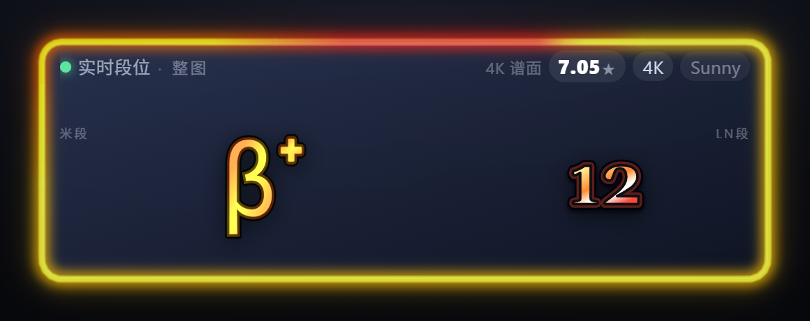
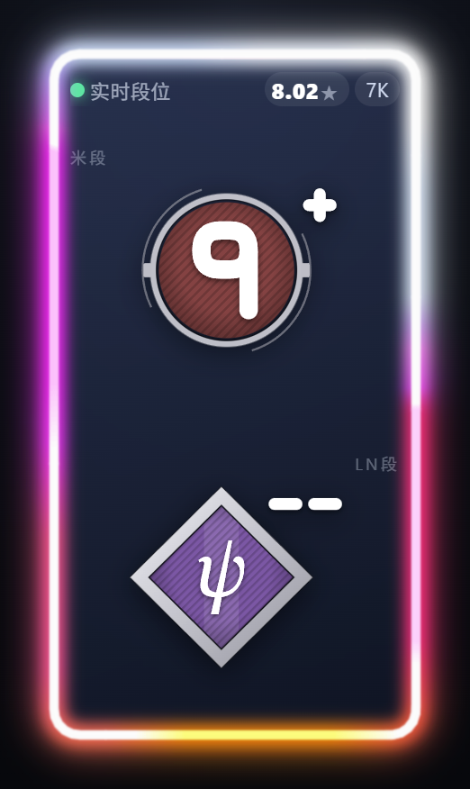
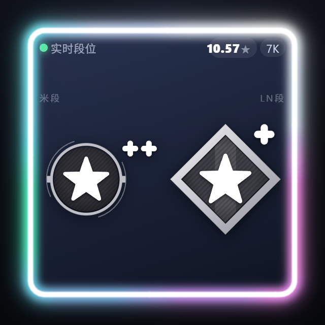

# ManiaLiveDan

**实时 osu!mania 段位 overlay（tosu 插件）**

按当前播放位置做**自适应分段**：难度长时间稳定的区段合并成长段并保持不动，
难度在变化的区段保留更短、更密集的段，跨过段边界才切换。

**0.4.0 起支持 4K / 6K / 7K 三套独立段位体系**，并且算法全部内置，不再依赖 ManiaMapAnalyser。

## 预览

<p align="center">
  
  
</p>

<p align="center">
  
</p>

## 支持的段位阶梯

| 键数 | RC | LN |
| --- | --- | --- |
| 4K | `Reform 1`–`Reform 10` → `α / β / γ / δ / ε / ζ / η / θ / ι / κ` | `LN 1`–`LN 17` |
| 6K | `Regular 0`–`Regular 9` → `Terra / Celestial / Mystery / Nihility / Finish` | 同 RC |
| 7K | `Regular 0`–`Regular 10` → `Gamma / Azimuth / Zenith / Stellium` | 同 RC |

- 每档再分 5 小档：`low / mid-low / mid / mid-high / high`
- 5K / 8K / 9K / 10K 没有段位表，只显示星数
- 7K 不做 `Wild` 表；超过 Stellium 封顶在 `Stellium high`

> ⚠️ **6K 的 Terra…Finish 五档是推算值**，不是官方阈值。上游 ManiaMapAnalyser 的 6K 表只到
> `Regular 9 high`（7.965 星），网页的 6K 阶梯还有这五档但星数区间未公开。这里按上游自己的
> 档距递减规律接上去（Regular 8 宽 0.36、Regular 9 宽 0.33，之后每档 ×0.917 收窄），
> 合计 7.965 → 9.246 星。代码里标了 `extrapolated`。

## 安装

1. 把整个 `ManiaLiveDan.by.MiraiFx` 文件夹放进 tosu 的 `static` 目录
   （默认 `C:\Tosu\static\`，不要多套一层文件夹）。
2. 重启 tosu 或刷新 dashboard → Counters 列表里会出现 **ManiaLiveDan**。
3. 游戏内 overlay 选中它，或 OBS 浏览器源打开：
   `http://localhost:24050/ManiaLiveDan.by.MiraiFx/`

用 git 装的话，注意**文件夹名要保持 `ManiaLiveDan.by.MiraiFx`**（tosu 用它当计数器名）：

```bash
cd C:/Tosu/static
git clone https://github.com/<你的用户名>/ManiaLiveDan.git ManiaLiveDan.by.MiraiFx
```

之后 `git pull` 就能直接更新正在用的计数器。

## 整图算法（面板里选）

tosu 面板的计数器设置里有三个下拉，每个键数各自独立：

| 键数 | 可选算法 | 默认 |
| --- | --- | --- |
| 4K | `Mixed / Azusa / Roxy / Sunny / Daniel / Companella` | Mixed |
| 6K | `Mixed / Sunny / Daniel` | Mixed |
| 7K | `Mixed / Sunny / Daniel` | Mixed |

- **Azusa / Roxy 源码里只支持 4K**，所以 6K/7K 不提供这两项
- **Companella 只对 4K 有意义**（它吃的是 4K 的 MSD 口径）
- 改了下拉 → **当前这张谱立刻重算**
- 「当前这段」固定用 Sunny：只有它带局部信息，Mixed 喂 5–20 秒片段会退化成窗口长度的单调函数

## Vibro 段判定

vibro 是「单列速度超过人类手指连打极限」的段落。星数算法一定会把它当极限 JackSpeed 算高
（RPG 7* 里那段会被算成 `LN17+ε`），但会 vibro 的人能轻松过，所以这个数字对玩家是误导。

本插件**不改难度算法**，只在分段层独立判定，判成 vibro 的段落显示 `VIBRO`，不给段位数字。

四条判据（同时成立）：

1. 最忙单列 ≥ **10 NPS**（正常手指上限约 9–10）
2. 同列相邻间隔中位数 ≤ **100ms**
3. 该列音符的**单音率 ≥ 0.4** —— 至少四成音符是单独落下的，不是全被和弦裹住
4. 连续超短间隔持续 ≥ **1.0s**

第 3 条专门用来挡住「高速三押叠键」：三押时每一列都能刷到 20 NPS，只靠 1、2 条分不开。
阈值放到 100ms / 0.4 是为了让「锚点连打」也算 vibro——某一列 97ms 一下不停地响、
其它列叠和弦上去（RPG Overdrive 158s / 170s 那段）。三押叠键的单音率接近 0，仍会被挡住。

判定在**整张谱**上找连打串，再按时间归到各段（段内占比 ≥ 45% 才整段标 VIBRO），
因为 vibro 串通常只有 1–1.5 秒，逐段找会被边界切断。

## 显示

| 区域 | 含义 |
| --- | --- |
| 左上 | 连接/状态、`4K`/`6K`/`7K`、mods、算法标签 |
| **米段** | 当前段落的 RC 段位徽章 |
| **LN段** | 同一段落的 LN 段位徽章，与米段同尺寸并排 |
| 星数徽章 | 当前段落的 Sunny 星数 |
| `整图` | 整张谱面的段位（按选中的算法） |

- 徽章素材取自 mania-tracker，**分档直接换图**（`-low / -mid-low / -mid-high / -high`），
  默认不再画 `-- / - / + / ++` 符号，也不显示 `Reform` / `Regular` 前缀
- 面板里可开 **Show Tier Mark / 显示分档角标**：在徽章右上角额外补一个 `-- / - / + / ++` 上标（默认关）
- **整张谱没有 LN 段位**（零长条，或低于 LN 表下限）→ LN 块**整块不显示**，选歌界面也不画杠
- 有 LN 段位时：**打歌中**当前段没有 LN → 隐藏；**选歌/待机** → 一直显示
- 竖长窗口（宽高比 ≤4:5）自动把米段/LN 段上下排

## 霓虹灯

- **RC 1–10 段**：白色系，越上越白
- **RC 10 段以上（具名档）**：用各自的手调色卡（`js/app/modes/palettes.js`）。
  网页这些徽章本身是单色银质，抽色抽不出区分度，所以手调了一套递进色
- **LN 1–10**：白色（0.4.0 起删掉了原来的浅水蓝）
- **6K / 7K 整体比 4K 亮一档**：难度系数 ×1.5，转速同步 +50%
- **呼吸**：4K 从 `rank ≥ 14`（Delta）起；**6K/7K 从 7dan 起**，暗端钉在自己 7dan 的亮度
- 弧长：`RC rank × 2 : LN rank`，LN 封顶 1/3

## 可调参数

`js/app/config.js`：

- `defaultAlgorithm`：面板没设置时的默认算法（默认 `Mixed`）
- `estimatorTimeoutMs`：单次整图分析超时（默认 60s）
- `showLnMinStar`：4K 的 LN 显示门槛（默认 4.84；6K/7K 用各自表下限）
- `segmentationEnabled` / `segmentCurveWindowMs` / `segmentMinMs`：自适应分段
- `extendedRange`：4K 用扩展段位表（默认 `false`）
- `glowBaseSpeed` / `glowRcShareWeight`：光环线速度与弧长权重

## 实现要点

- 谱面来源：tosu `/websocket/v2` + `/files/beatmap/file`
- 三个模块：`js/app/modes/mode4k.js` / `mode6k.js` / `mode7k.js`，各自带段位表、徽章路径、
  LN 门槛、光环参数；改 6K 不会碰到 4K
- 算法：`js/lib/estimator/`（Sunny / Daniel / Azusa / Roxy / Mixed / Companella），
  Etterna（MSD）在 `js/lib/ett/`，ONNX 运行时在 `js/lib/estimator/companella/`
- 长度口径：用整张图的长度因子替换切片自身的长度因子，让「段落段位」与「整图段位」同一把尺子

## 已知限制

- 6K 的 Terra…Finish 是推算值
- 插件体积约 15 MB（含 ONNX 运行时），首次加载会有几秒预热
- 移植的算法若上游更新，需要手动同步
- 5K / 8K / 9K / 10K 无段位表

## 致谢 / 许可

- 算法与段位区间表：**ManiaMapAnalyser** by Leo_Black — MIT
  https://github.com/LeoBlackMT/osumania_map_analyser
- 原始算法：**Sunny Rework**（Star-Rating-Rebirth） by sunnyxxy
  https://github.com/sunnyxxy/Star-Rating-Rebirth
- 段位徽章素材：**mania-tracker.com**
- 运行环境：**tosu** — https://tosu.app

本插件自身代码以 MIT 发布，详见 `NOTICE.md`。

## 开发

没有构建步骤，全是原生 ES Module，改完刷新页面即可。

```
js/app/          应用层（模式分发、分段、UI、vibro 判定）
js/lib/          移植进来的算法（estimator / ett / interlude / patterns / pipeline）
assets/dan/      段位徽章，4k / 6k / 7k 三套
styles.css       卡片与光晕样式
```

调试时可以用浏览器直接打开计数器页面，控制台里 `window.__MLD` 有当前分析结果与设置快照。

## 许可证

本项目以 [MIT](LICENSE) 发布。内置的第三方算法与图片素材各有其授权，详见 [NOTICE.md](NOTICE.md)。
