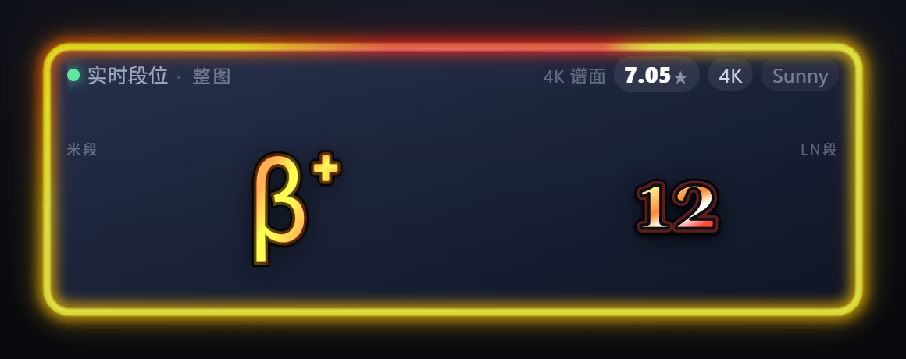
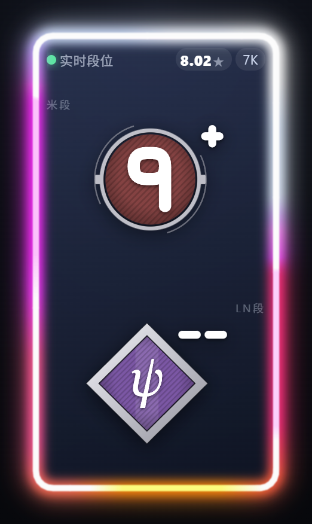
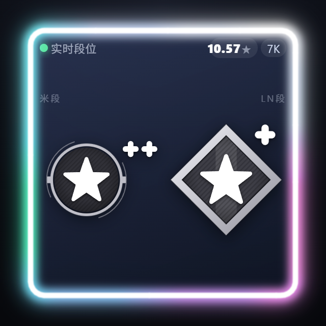

# ManiaLiveDan

**English** · [中文 ↓](#中文) · [中文单独页面](README.zh-CN.md)

**Real-time osu!mania dan overlay (tosu plugin)**
**实时 osu!mania 段位 overlay(tosu 插件)**

<p align="center">
  <a href="https://github.com/M1ra1Fx/ManiaLiveDan/releases/latest/download/ManiaLiveDan.by.MiraiFx.zip">
    
  </a>
  <a href="https://github.com/M1ra1Fx/ManiaLiveDan/releases">
    
  </a>
  
  
</p>

Segments adapt to the current playback position: stretches where difficulty stays stable are
merged into long, held segments, while stretches that change keep shorter, denser segments.
The display only switches when you cross a segment boundary.

**Since 0.4.0 there are three independent dan systems for 4K / 6K / 7K**, and every algorithm is
bundled locally — ManiaMapAnalyser is no longer required.

**0.5.0 adds: optional Prism algorithm for 6K / 7K (beta)** — switch it in the panel, the default
is still the Sunny scale.

**0.5.1**: Prism now converts scores by inverting Prism's own maths instead of a fitted curve, plus
licensing/NOTICE cleanup and bilingual docs. Prism remains beta.

## Preview

<p align="center">
  
  
</p>

<p align="center">
  
</p>

## Supported dan ladders

| Keys | RC | LN |
| --- | --- | --- |
| 4K | `Reform 1`–`Reform 10` → `α / β / γ / δ / ε / ζ / η / θ / ι / κ` | `LN 1`–`LN 17` |
| 6K | `Regular 0`–`Regular 9` → `Terra / Celestial / Mystery / Nihility / Finish` | same as RC |
| 7K | `Regular 0`–`Regular 10` → `Gamma / Azimuth / Zenith / Stellium` | same as RC |

- Every tier is split into 5 sub-tiers: `low / mid-low / mid / mid-high / high`
- 5K / 8K / 9K / 10K have no dan table and only show star rating
- 7K has no `Wild` table; anything above Stellium caps at `Stellium high`

> ⚠️ **The 6K `Terra…Finish` tiers are extrapolated**, not official thresholds. The upstream
> ManiaMapAnalyser 6K table stops at `Regular 9 high` (7.965 stars); the web ladder lists these
> five further tiers but the star ranges are not published. They are appended using upstream's own
> shrinking step pattern (Regular 8 spans 0.36, Regular 9 spans 0.33, then each tier narrows ×0.917),
> giving 7.965 → 9.246 stars in total. This is marked `extrapolated` in the code.

## Installation

> Use the **Download** button at the top of this page to grab the zip, then unpack it as below.

1. Put the whole `ManiaLiveDan.by.MiraiFx` folder into tosu's `static` directory
   (by default `C:\Tosu\static\` — do not nest it an extra level).
2. Restart tosu or refresh the dashboard → **ManiaLiveDan** appears in the Counters list.
3. Select it as your in-game overlay, or open it as an OBS browser source:
   `http://localhost:24050/ManiaLiveDan.by.MiraiFx/`

To install with git, **keep the folder name `ManiaLiveDan.by.MiraiFx`** (tosu uses it as the
counter name):

```bash
cd C:/Tosu/static
git clone https://github.com/M1ra1Fx/ManiaLiveDan.git ManiaLiveDan.by.MiraiFx
```

After that, `git pull` updates the counter you are using directly.

## Language

The overlay interface defaults to **English**. To switch it, open the counter settings in the
tosu panel and change **Language / 语言** (`en` / `zh`). The change takes effect immediately —
no page refresh needed.

The default for fresh installs lives in `js/app/config.js` (`language: "en"`), and the panel
setting in `settings.json` overrides it.

## Whole-map algorithm (chosen in the panel)

The tosu panel's counter settings have three dropdowns, one per key mode:

| Keys | Available algorithms | Default |
| --- | --- | --- |
| 4K | `Mixed / Azusa / Roxy / Sunny / Daniel / Companella` | Mixed |
| 6K | `Mixed / Sunny / Prism / Daniel` | Mixed |
| 7K | `Mixed / Sunny / Prism / Daniel` | Mixed |

- **Azusa / Roxy only support 4K in their source**, so they are not offered for 6K/7K
- **Companella is only meaningful for 4K** (it consumes the 4K MSD scale)
- **Prism (beta)** only supports 6K / 7K / 8K — see the dedicated section below
- Changing a dropdown → **the current beatmap is re-estimated immediately**
- "Current segment" always uses Sunny: it is the only estimator with local information; feeding a
  5–20 second slice to Mixed degenerates into a monotonic function of window length

## Prism algorithm for 6K / 7K (beta)

[Prism](https://mania-tracker.com/news/prism) is the difficulty calculator mania-tracker built for
6K–8K, replacing MinaCalc on those keymodes. MinaCalc was written for 4K, and on 7K it gets three
things wrong:

| Problem | Example (official announcement data) |
| --- | --- |
| Reads jumptrills as fast streams | `[7K] Jumptrill ~>` — MinaCalc 43.5 → Prism **18.0** |
| Rate-shifted charts explode | Same chart at 1.3x — 56.1 → **30.0** |
| No idea what LN is | `[7K] Challenge` (LN-heavy) — 4.9 → **18.5** |

Prism rates Chordstream / Bracket / Jack / Technical / Delay, plus LN on charts with enough holds.

**How it is integrated.** The upstream Rust source (MIT, v0.25) is compiled to wasm **unmodified** —
not a single line of the algorithm was changed — behind a dependency-free C-ABI shim. Fidelity was
checked against the 12 benchmark charts hard-coded in the announcement: Overall error ≤ 0.03 on
10 of 12.

**How the score becomes a dan.** Prism outputs its own 0–50 scale, so it needs converting to the
star-rating scale the dan tables use. Instead of fitting a curve, we invert Prism's own maths:
`prism_rating_of_strain()` is a log-domain linear interpolation, so `rating → strain` is an **exact
inverse** (verified to 1e-15). The resulting strain is already on the star-rating scale — across
11 benchmark charts the strain / Sunny-star ratio averages **1.00** — so it feeds the existing dan
tables **with no free parameters at all**.

RC and LN take separate paths: Prism's `Overall` uses the press model and barely sees holds, so
LN-heavy charts score higher on the LN number (Avril 14th: Overall 18.5, LN 27.1). RC uses the
exact inverse; LN uses a 5-sample regression because its internal scale is different. LN only
applies to real LN charts — the official threshold is 37.5% holds on 7K (45% on 6K/8K).

> ⚠️ **Prism is a beta feature and comes with no accuracy guarantee.** Its RC path has no fitted
> parameters, but its LN regression is fitted on only 5 charts and 6K has just 2 samples.
> mania-tracker's own Terms of Service state that its generated surfaces — **dan estimates
> included — "may be delayed, incomplete, unavailable, or incorrect"**, and the dan derived here
> carries the same caveat. It is **not** claimed to be more accurate than the Sunny-based dan, just
> a different measurement of difficulty. Use `Sunny` / `Mixed` if you want stable,
> community-consistent dan. Details are in
> [`js/lib/estimator/prism/BENCHMARK.md`](js/lib/estimator/prism/BENCHMARK.md).
>
> This plugin is **not affiliated with** mania-tracker, mania-hub or aleju03 in any way, and makes
> **no runtime requests** to their servers — all scoring runs locally in the bundled wasm.

## Vibro segment detection

Vibro is a stretch where a single column's speed exceeds what human fingers can tap. Star rating
algorithms will inevitably rate it high as extreme JackSpeed (in RPG 7* that stretch comes out as
`LN17+ε`), but players who can vibro clear it comfortably — so that number misleads players.

This plugin **does not change the difficulty algorithm**; it only detects vibro independently at the
segmentation layer. Segments classified as vibro display `VIBRO` instead of a dan number.

Four criteria (all must hold):

1. Busiest single column ≥ **10 NPS** (the normal finger limit is around 9–10)
2. Median gap between consecutive notes in that column ≤ **100 ms**
3. That column's **single-note ratio ≥ 0.4** — at least 40% of its notes land alone, rather than
   all being wrapped inside chords
4. Consecutive ultra-short gaps lasting ≥ **1.0 s**

Criterion 3 exists specifically to reject "fast triple-stack chords": during triple stacks every
column can hit 20 NPS, and criteria 1 and 2 alone cannot tell the two apart. The thresholds were
loosened to 100 ms / 0.4 so that "anchor spam" also counts as vibro — one column firing
continuously at 97 ms with chords stacked on the other columns (the RPG Overdrive 158 s / 170 s
stretch). Triple-stack chords have a single-note ratio near 0 and are still rejected.

Detection looks for spam runs across the **entire beatmap** and then assigns them to segments by
time (a segment is marked VIBRO when ≥ 45% of it is covered), because vibro runs usually last only
1–1.5 seconds and per-segment detection would cut them at boundaries.

## Display

| Area | Meaning |
| --- | --- |
| Top-left | Connection/status, `4K`/`6K`/`7K`, mods, algorithm tag |
| **RC DAN** | RC dan badge for the current segment |
| **LN DAN** | LN dan badge for the same segment, side by side at the same size |
| Star badge | Sunny star rating for the current segment |
| `Whole map` | Dan for the entire beatmap (using the selected algorithm) |

- Badge art comes from mania-tracker, and **the sub-tier swaps the image directly**
  (`-low / -mid-low / -mid-high / -high`). The `-- / - / + / ++` marks and the
  `Reform` / `Regular` prefix are no longer drawn by default
- The panel offers **Show Tier Mark**: adds a `-- / - / + / ++` superscript at the badge's
  top-right corner (off by default)
- **No LN dan anywhere in the beatmap** (zero hold notes, or below the LN table floor) → the LN
  block is **hidden entirely**, and no dash is drawn in song select either
- When LN dan exists: **during play** it hides if the current segment has no LN;
  **in song select / idle** it is always shown
- Tall windows (aspect ratio ≤ 4:5) automatically stack the RC and LN blocks vertically

## Neon glow

- **RC tiers 1–10**: white palette, brighter the higher you go
- **RC above tier 10 (named tiers)**: each uses its own hand-tuned palette
  (`js/app/modes/palettes.js`). The web badges are monochrome silver, so sampling their colors
  yields no differentiation — a graded palette was tuned by hand instead
- **LN 1–10**: white (the earlier pale-aqua was removed in 0.4.0)
- **6K / 7K are one step brighter than 4K overall**: difficulty coefficient ×1.5, spin speed +50%
- **Breathing**: 4K starts at `rank ≥ 14` (Delta); **6K/7K start at 7dan**, with the dark end
  pinned to that mode's own 7dan brightness
- Arc length: `RC rank × 2 : LN rank`, with LN capped at 1/3

## Tunable parameters

In `js/app/config.js`:

- `language`: interface language when the panel has no setting (default `"en"`)
- `defaultAlgorithm`: algorithm used when the panel has no setting (default `Mixed`)
- `estimatorTimeoutMs`: per whole-map analysis timeout (default 60 s)
- `showLnMinStar`: 4K's LN display floor (default 4.84; 6K/7K use their own table floors)
- `segmentationEnabled` / `segmentCurveWindowMs` / `segmentMinMs`: adaptive segmentation
- `extendedRange`: use 4K's extended dan table (default `false`)
- `glowBaseSpeed` / `glowRcShareWeight`: glow linear speed and arc-length weights

## Implementation notes

- Beatmap source: tosu `/websocket/v2` + `/files/beatmap/file`
- Three modules: `js/app/modes/mode4k.js` / `mode6k.js` / `mode7k.js`, each carrying its own dan
  table, badge paths, LN floor and glow parameters; changing 6K never touches 4K
- Algorithms: `js/lib/estimator/` (Sunny / Daniel / Azusa / Roxy / Mixed / Companella),
  Etterna (MSD) in `js/lib/ett/`, ONNX runtime in `js/lib/estimator/companella/`
- Prism: `js/lib/estimator/prism/` (compiled wasm + loader + calibration)
- Length scale: the slice's own length factor is replaced with the whole-map length factor, so
  segment dan and whole-map dan are measured with the same ruler

## Known limitations

- The 6K `Terra…Finish` tiers are extrapolated values
- **Prism is beta**: its calibration samples are insufficient, so dan may differ from Sunny by 1–3 tiers
- The plugin is roughly 15 MB (it bundles the ONNX runtime); the first load takes a few seconds to warm up
- If an upstream algorithm is ported and later updated, the copy must be synced manually
- 5K / 8K / 9K / 10K have no dan table

## Credits / License

- Algorithms and dan interval tables: **ManiaMapAnalyser** by Leo_Black — MIT
  https://github.com/LeoBlackMT/osumania_map_analyser
- Original algorithm: **Sunny Rework** (Star-Rating-Rebirth) by sunnyxxy
  https://github.com/sunnyxxy/Star-Rating-Rebirth
- **Prism**: by aleju03 (mania-tracker) — MIT
  https://github.com/aleju03/mania-hub/tree/HEAD/algorithms/prism
- Dan badge art: **mania-tracker.com**
- Runtime environment: **tosu** — https://tosu.app

This plugin's own code is released under MIT; see `NOTICE.md` for details.

## Development

There is no build step — everything is plain ES modules, so just edit and refresh the page.

```
js/app/          application layer (mode dispatch, segmentation, UI, vibro detection)
js/lib/          ported algorithms (estimator / ett / interlude / patterns / pipeline)
assets/dan/      dan badges, three sets: 4k / 6k / 7k
styles.css       card and glow styling
```

For debugging you can open the counter page directly in a browser; `window.__MLD` in the console
holds the current analysis result and a settings snapshot.

## License

This project is released under [MIT](LICENSE). The bundled third-party algorithms and image assets
carry their own licenses; see [NOTICE.md](NOTICE.md).

---

<a id="中文"></a>

# 中文

> 这一页默认显示英语，中文紧跟在下面。也可以打开 [纯中文页面](README.zh-CN.md)。

分段会跟着当前播放位置自适应：难度稳定的一段合并成较长的段，难度在变化的地方保持较短、
更密的段。只有跨过段边界时显示才会切换。

**0.4.0 起支持 4K / 6K / 7K 三套独立段位体系**，并且算法全部内置，不再依赖 ManiaMapAnalyser。

**0.5.0 新增：6K / 7K 可选 Prism 算法（测试版）**，在设置面板里切换即可，默认仍是 Sunny 口径。

**0.5.1**：Prism 的分数换算改为反解 Prism 自身的数学（不再拟合曲线），并做了许可声明清理与
文档双语化。Prism 仍是测试版。

## 预览

> 图片见上方英文部分的「Preview」。

## 支持的段位阶梯

| 键数 | RC | LN |
| --- | --- | --- |
| 4K | `Reform 1`–`Reform 10` → `α / β / γ / δ / ε / ζ / η / θ / ι / κ` | `LN 1`–`LN 17` |
| 6K | `Regular 0`–`Regular 9` → `Terra / Celestial / Mystery / Nihility / Finish` | 同 RC |
| 7K | `Regular 0`–`Regular 10` → `Gamma / Azimuth / Zenith / Stellium` | 同 RC |

- 每档再分 5 小档：`low / mid-low / mid / mid-high / high`
- 5K / 8K / 9K / 10K 没有段位表，只显示星数
- 7K 不做 `Wild` 表；超过 Stellium 封顶在 `Stellium high`

> ⚠️ **6K 的 Terra…Finish 五档是推算值**，不是官方阈值。上游 ManiaMapAnalyser 的 6K 表只到
> `Regular 9 high`（7.965 星），网页的 6K 阶梯还有这五档但星数区间未公开。这里按上游自己的
> 档距递减规律接上去（Regular 8 宽 0.36、Regular 9 宽 0.33，之后每档 ×0.917 收窄），
> 合计 7.965 → 9.246 星。代码里标了 `extrapolated`。

## 安装

> 点页面顶部的 **Download / 下载插件** 按钮拿到 zip，解压后按下面步骤放进去即可。

1. 把整个 `ManiaLiveDan.by.MiraiFx` 文件夹放进 tosu 的 `static` 目录
   （默认 `C:\Tosu\static\`，**不要再套一层**）。
2. 重启 tosu 或刷新面板 → Counters 列表里出现 **ManiaLiveDan**。
3. 在游戏内选它做 overlay，或作为 OBS 浏览器源打开：
   `http://localhost:24050/ManiaLiveDan.by.MiraiFx/`

用 git 安装时，**文件夹名必须保持 `ManiaLiveDan.by.MiraiFx`**（tosu 用它当计数器名）：

```bash
cd C:/Tosu/static
git clone https://github.com/M1ra1Fx/ManiaLiveDan.git ManiaLiveDan.by.MiraiFx
```

之后 `git pull` 就能直接更新你在用的计数器。

## 语言

界面默认 **英语**。要改的话，在 tosu 面板的计数器设置里改 **Language / 语言**（`en` / `zh`），
改完立刻生效，不用刷新页面。

全新安装的默认值在 `js/app/config.js`（`language: "en"`），面板里的设置会覆盖它。

## 整图算法（面板里选）

tosu 面板的计数器设置里有三个下拉框，每个键数一个：

| 键数 | 可选算法 | 默认 |
| --- | --- | --- |
| 4K | `Mixed / Azusa / Roxy / Sunny / Daniel / Companella` | Mixed |
| 6K | `Mixed / Sunny / Prism / Daniel` | Mixed |
| 7K | `Mixed / Sunny / Prism / Daniel` | Mixed |

- **Azusa / Roxy 源码里只支持 4K**，所以 6K/7K 不提供
- **Companella 只对 4K 有意义**（它吃的是 4K 的 MSD 口径）
- **Prism（测试版）**只支持 6K / 7K / 8K —— 见下节
- 改下拉框 → **当前谱面会立刻重新估算**
- 「当前这一段」固定用 Sunny：它是唯一有局部信息的估算器；把 5–20 秒的切片喂给 Mixed
  会退化成窗口长度的单调函数

## 6K / 7K 的算法：Sunny 或 Prism（测试版）

[Prism](https://mania-tracker.com/news/prism) 是 mania-tracker 为 6K~8K 编写的难度算法，用来
取代 MinaCalc 在那几个键数上的判断。MinaCalc 是为 4K 写的，套到 7K 上会犯三类错：

| 问题 | 例子（官方公告数据） |
| --- | --- |
| 把轮指（jumptrill）当高速流 | `[7K] Jumptrill ~>`：MinaCalc 43.5 → Prism **18.0** |
| 变速图爆涨 | 同一张 1.3x：56.1 → **30.0** |
| 完全不认识 LN | `[7K] Challenge`（重 LN 图）：4.9 → **18.5** |

Prism 评 Chordstream / Bracket / Jack / Technical / Delay，LN 够多的图还会给 LN。

**怎么接的。** 把上游 Rust 源码(MIT,v0.25)**原样编译成 wasm** —— 算法一行未改 —— 外面套一层
零依赖的 C-ABI 出口。保真度用公告里硬编码的 12 张标尺图验证过:Overall 误差 ≤ 0.03(12 张里
有 10 张)。

**分数怎么变成段位。** Prism 输出的是它自己的 0~50 刻度,需要换算到段位表用的星数刻度。
这里不拟合曲线,而是**反解 Prism 自己的数学**:`prism_rating_of_strain()` 是对数域线性插值,
所以 `分 → strain` 是**精确逆运算**(验证误差 1e-15)。反解出的 strain 本身就在星级刻度上 ——
11 张标尺图的 strain / Sunny 星数比值**均值恰好 1.00** —— 直接喂现有段位表,**零自由参数**。

RC 和 LN 走两条路:Prism 的 `Overall` 走 press 模型、几乎不感知长条,纯 LN 图的 LN 分会明显更高
(Avril 14th:Overall 18.5,LN 27.1)。所以 RC 用精确反解,LN 用 5 张样本的回归(LN 内部分布是另一套
刻度)。LN 只对真正的 LN 图生效 —— 官方门槛是 7K 长条占比 37.5%(6K/8K 是 45%)。

> ⚠️ **Prism 目前是测试版,不提供任何准确性保证。** RC 那条路没有拟合参数,但 LN 回归只有 5 张
> 样本,6K 更是只有 2 张。mania-tracker 自己的服务条款写明,它生成的界面(包括段位估计)
> 「may be delayed, incomplete, unavailable, or **incorrect**」—— 本插件从 Prism 得出的段位
> 同样带着这个前提,它**不是**「比 Sunny 更准」,只是另一套衡量难度的口径。要稳定、与社区认知
> 一致的段位,请用 `Sunny` / `Mixed`。细节见
> [`js/lib/estimator/prism/BENCHMARK.md`](js/lib/estimator/prism/BENCHMARK.md)。
>
> 本插件与 mania-tracker / mania-hub / aleju03 **没有任何隶属关系**,运行时也**不会请求**
> 他们的服务器 —— 所有计算都在本地 wasm 里完成。

## Vibro 段判定

Vibro 是「单列速度超过人类手指连打极限」的段落。星数算法一定会把它当极限 JackSpeed 算高
（RPG 7* 那一段会算成 `LN17+ε`），但会 vibro 的玩家打起来很轻松，所以那个数字会误导玩家。

本插件**不改难度算法**，只在分段层独立判定。判成 vibro 的段落显示 `VIBRO`，不给段位数字。

四条判据（同时满足）：

1. 最忙单列 ≥ **10 NPS**（正常手指极限大约 9–10）
2. 该列相邻音符间隔中位数 ≤ **100 ms**
3. 该列**单音占比 ≥ 0.4** —— 至少 40% 的音是单独落下的，而不是全包在和弦里
4. 连续超短间隔持续 ≥ **1.0 秒**

判据 3 是专门用来排除「快速三押」的：三押时每一列都能跑到 20 NPS，光靠判据 1、2 分不出来。
阈值放宽到 100 ms / 0.4 是为了让「锚点刷」也算 vibro —— 一列以 97 ms 持续输出、其他列叠和弦
（RPG Overdrive 158 s / 170 s 那段）。三押的单音占比接近 0，仍然会被排除。

判定是**整张图**先找出连打段，再按时间分配到各段（覆盖 ≥ 45% 才算 VIBRO），因为 vibro 段
通常只有 1–1.5 秒，按段单独找会被边界切断。

## 显示

| 区域 | 含义 |
| --- | --- |
| 左上 | 连接/状态、`4K`/`6K`/`7K`、mods、算法标签 |
| **米段** | 当前段的 RC 段位徽章 |
| **LN段** | 同一段的 LN 段位徽章，与米段同尺寸并排 |
| 星数徽章 | 当前段的 Sunny 星数 |
| `整图` | 整张谱面的段位（按选中的算法） |

- 徽章素材来自 mania-tracker，**分档直接换图**（`-low / -mid-low / -mid-high / -high`）。
  `-- / - / + / ++` 角标和 `Reform` / `Regular` 前缀默认不再画
- 面板里有 **Show Tier Mark**：在徽章右上角额外加 `-- / - / + / ++` 角标（默认关）
- **整张谱没有 LN 段位**（零长条，或低于 LN 表下限）→ LN 块**整块隐藏**，选歌界面也不画杠
- 有 LN 段位时：**打歌中**当前段没有 LN → 隐藏；**选歌/待机** → 一直显示
- 竖版窗口（宽高比 ≤ 4:5）自动把 RC / LN 两块竖着叠

## 霓虹灯

- **RC 1–10 档**：白色系，越往上越亮
- **RC 10 档以上（具名档）**：各用自己调好的配色（`js/app/modes/palettes.js`）。网页徽章本身是
  单色银，采样取不到区分度，所以是手调的渐变配色
- **LN 1–10**：白色（0.4.0 起删掉了原来的浅水蓝）
- **6K / 7K 整体比 4K 亮一档**：难度系数 ×1.5，转速 +50%
- **呼吸**：4K 从 `rank ≥ 14`（Delta）开始；**6K/7K 从 7dan 起**，暗端钉在该模式自己的 7dan 亮度
- 弧长：`RC 档位 × 2 : LN 档位`，LN 最多占 1/3

## 可调参数

在 `js/app/config.js`：

- `language`：面板没设置时的界面语言（默认 `"en"`）
- `defaultAlgorithm`：面板没设置时用的算法（默认 `Mixed`）
- `estimatorTimeoutMs`：整图分析超时（默认 60 秒）
- `showLnMinStar`：4K 的 LN 显示门槛（默认 4.84；6K/7K 用各自表下限）
- `segmentationEnabled` / `segmentCurveWindowMs` / `segmentMinMs`：自适应分段
- `extendedRange`：4K 用扩展段位表（默认 `false`）
- `glowBaseSpeed` / `glowRcShareWeight`：光环线速度与弧长权重

## 实现要点

- 谱面来源：tosu `/websocket/v2` + `/files/beatmap/file`
- 三个模块：`js/app/modes/mode4k.js` / `mode6k.js` / `mode7k.js`，各自带段位表、徽章路径、
  LN 门槛、光环参数；改 6K 不会影响 4K
- 算法：`js/lib/estimator/`（Sunny / Daniel / Azusa / Roxy / Mixed / Companella），
  Etterna（MSD）在 `js/lib/ett/`，ONNX 运行时在 `js/lib/estimator/companella/`
- Prism：`js/lib/estimator/prism/`（编译好的 wasm + 加载器 + 标定）
- 长度口径：用整张图的长度因子替换切片自身的长度因子，让「段落段位」与「整图段位」同一把尺子

## 已知限制

- 6K 的 `Terra…Finish` 五档是推算值
- **Prism 是测试版**：标定样本不足，段位可能与 Sunny 相差 1~3 档
- 插件约 15 MB（内置了 ONNX 运行时），首次加载要几秒预热
- 上游算法如果之后更新，需要手动同步
- 5K / 8K / 9K / 10K 无段位表

## 致谢 / 许可

- 算法与段位区间表：**ManiaMapAnalyser** by Leo_Black — MIT
  https://github.com/LeoBlackMT/osumania_map_analyser
- 原始算法：**Sunny Rework**（Star-Rating-Rebirth） by sunnyxxy
  https://github.com/sunnyxxy/Star-Rating-Rebirth
- **Prism**：by aleju03（mania-tracker）— MIT
  https://github.com/aleju03/mania-hub/tree/HEAD/algorithms/prism
- 段位徽章素材：**mania-tracker.com**
- 运行环境：**tosu** — https://tosu.app

本插件自身代码以 MIT 发布，详见 `NOTICE.md`。

## 开发

没有构建步骤 —— 全是原生 ES 模块，改完刷新页面即可。

```
js/app/          应用层（模式分发、分段、UI、vibro 判定）
js/lib/          移植的算法（estimator / ett / interlude / patterns / pipeline）
assets/dan/      段位徽章，4k / 6k / 7k 三套
styles.css       卡片与光环样式
```

调试时可以直接在浏览器打开计数器页面；控制台里的 `window.__MLD` 保存着当前分析结果和设置快照。

## 许可证

本项目以 [MIT](LICENSE) 发布。内置的第三方算法与图片素材各自遵循其许可证，详见 [NOTICE.md](NOTICE.md)。
